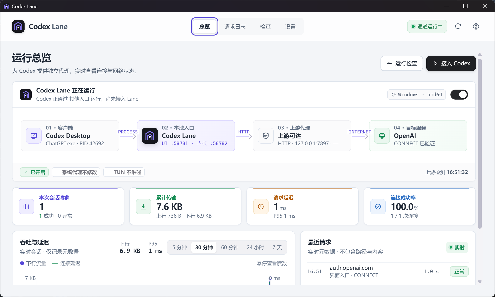
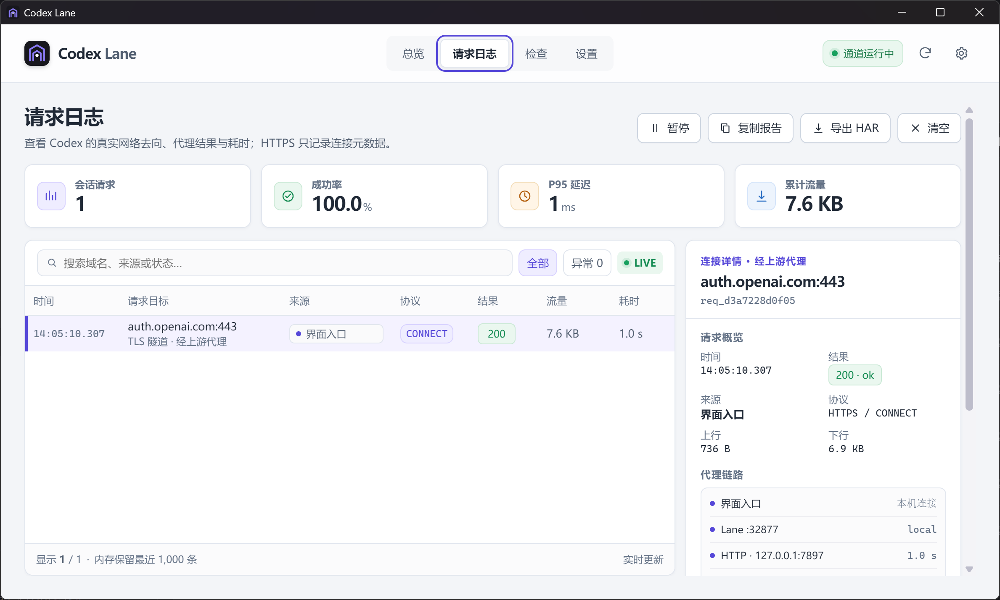
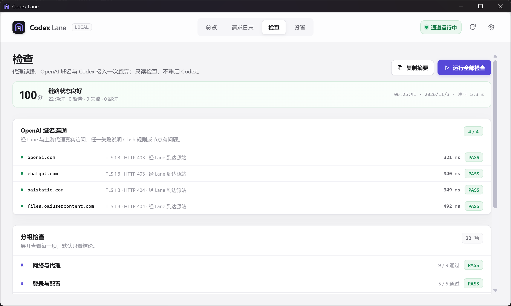
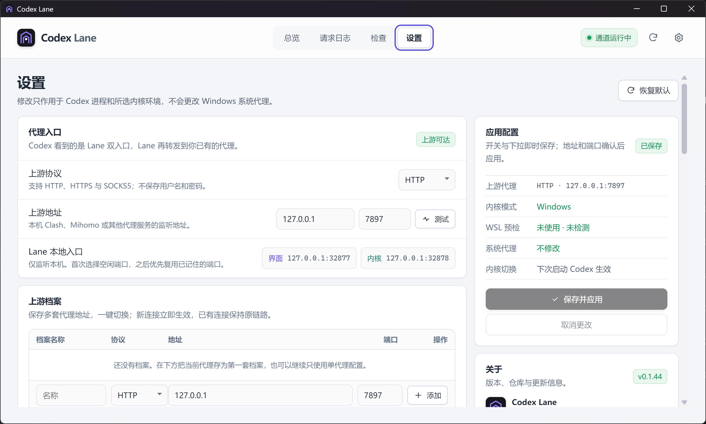
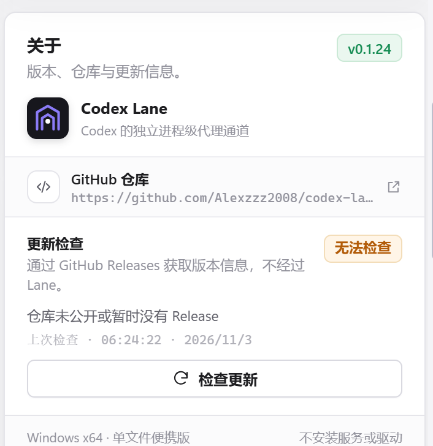

# Codex Lane

为 OpenAI Codex Desktop 提供独立进程级代理通道的 Windows 应用。

Codex Lane 只让 Codex 通过本地 Lane 转发到已有 HTTP、HTTPS 或 SOCKS5 代理，不改系统代理、不启用 TUN，也不影响其他应用。



## 工作方式

```text
Codex Desktop ── UI 入口 ──┐
                           ├── Codex Lane ── 已有代理 ── OpenAI
Codex 内核 ─── 内核入口 ───┘
```

- 界面层使用 `--proxy-server`，内核层使用代理环境变量，均指向 Lane。
- 自动识别 Windows 或 WSL2 内核，也可以手动切换。
- HTTPS 只记录域名、端口、结果、耗时和流量，不做 MITM。

## 功能

- **双入口**：界面与内核使用独立回环端口，支持一键启动、停止和重新接入 Codex。
- **自动接管**：从开始菜单或桌面图标打开 Codex 时，检测到未经过 Lane 会自动重启接入，可在设置中关闭。
- **多上游**：保存多套代理档案，支持测速、切换和故障自动切换。
- **分流控制**：按域名选择代理或直连；白名单可阻止其他程序借用 Lane。
- **请求日志**：查看代理链路、状态、延迟和流量，支持报告与 HAR 导出。
- **连通检查**：检查代理、Codex、WebView2、WSL2 与 OpenAI 域名。
- **桌面体验**：单文件 exe、托盘、开机自启，以及带 SHA-256 校验、失败回滚的一键自更新。

## 快速开始

1. 从 [Releases](https://github.com/Alexzzz2008/codex-lane/releases) 下载并解压最新便携版。
2. 运行 `CodexLane.exe`，确认上游代理地址和端口。
3. 在「总览」打开或重新接入 Codex，在「请求日志」确认实际代理链路。

同一时间只允许一个实例。手动替换 exe 后如果窗口仍是旧版本，请先右键托盘图标
「退出 Codex Lane」再重新打开；0.1.34 起会直接弹窗提示版本冲突。

## 命令行

```text
CodexLane.exe                    打开桌面控制台
CodexLane.exe --selftest         无界面自检
CodexLane.exe --selftest --json  输出 JSON 自检结果
CodexLane.exe --version          输出版本号
CodexLane.exe --check-webview2   检查 WebView2 Runtime
```

## 配置

```text
%LOCALAPPDATA%\CodexLane\launcher.json
%LOCALAPPDATA%\CodexLane\logs\requests-YYYYMMDD.jsonl
%LOCALAPPDATA%\CodexLane\logs\app.log
```

旧版放在 exe 同目录的 `launcher.json` 会自动迁移。日志默认保留 14 天。

## 边界

不管理代理节点、订阅、系统代理或 Codex 账号，也不支持需要用户名密码的代理认证。

## 构建

需要 Go 1.26+、Node.js 20+ 和 Wails v3 CLI。

```powershell
pwsh -File scripts/build.ps1
```

构建、发布与验收说明见 [docs/RELEASE.md](docs/RELEASE.md)。

## 界面

| 请求日志 | 检查 |
|---|---|
|  |  |

| 设置 | 关于 |
|---|---|
|  |  |
