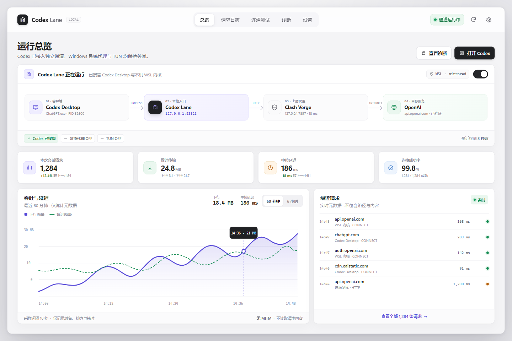
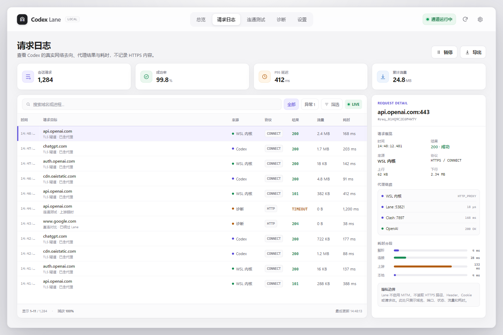
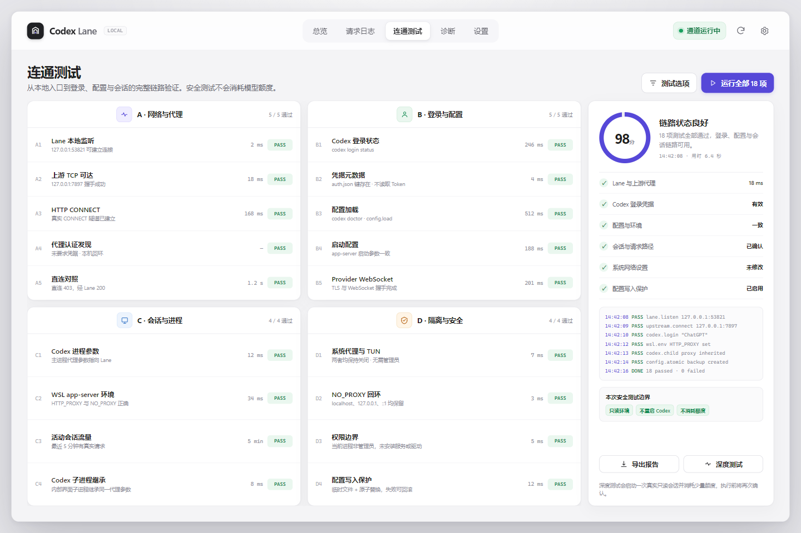
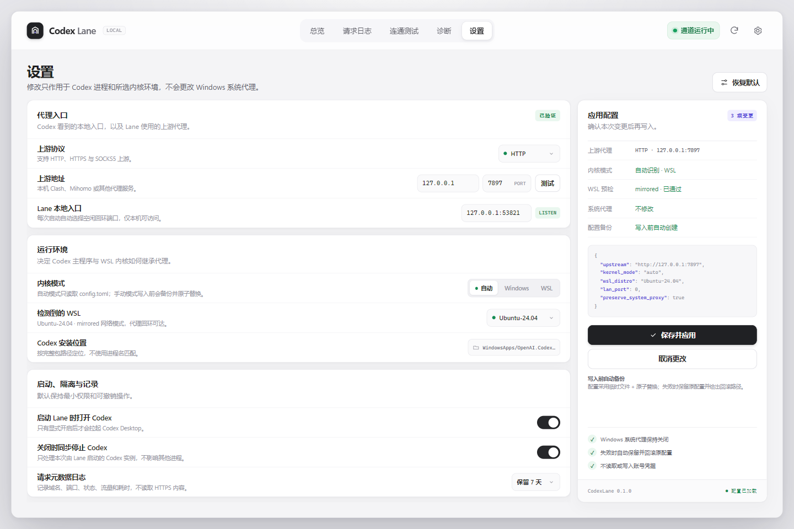

# Codex Lane

A dedicated proxy launcher for OpenAI Codex Desktop on Windows.

Codex Lane 让 **Codex 桌面端的两层网络**经过自己的本地观测网关，再转发到用户已有的代理：

- 应用界面层：使用 `--proxy-server` 指向 CodexLane 入口。
- Rust 内核层：使用 `HTTP_PROXY`、`HTTPS_PROXY`、`ALL_PROXY`、`NO_PROXY` 指向 CodexLane 入口。
- CodexLane 网关：监听随机 loopback 端口，转发到用户代理，并记录连接元数据。

它不开启系统代理，不启用 TUN，不修改 Clash 规则，也不影响其他应用。
Codex 内核可以运行在 Windows，也可以运行在 WSL2；工具会读取 Codex 配置并自动识别，
也可以由用户显式切换。

> Codex Lane 是**进程级代理启动器 + 本地观测网关**，不是 VPN。
> 本机必须已经有一个可用的 HTTP / HTTPS / SOCKS5 上游代理。

## 核心功能

- 一次启动同时覆盖应用界面层和 Rust 内核层。
- 可配置本地代理协议、地址和端口，默认适配 Clash mixed-port。
- Codex 内核支持 `自动 / Windows / WSL` 三种选择。
- `自动` 跟随 `config.toml`，不会自行改动 Codex 配置。
- 显式切换 Windows / WSL 时，只修改一个配置键，并在修改前备份。
- WSL 启动前检查发行版、内核文件和 interop 状态，失败时给出明确原因。
- 检测已有 Codex 实例，避免单实例机制导致新环境变量不生效。
- 提供 `--selftest` 无界面自检：代理可达性、OpenAI 连通性、安装路径、内核形态和实例状态。
- 启动前预检 WebView2 Runtime；缺失时可从原生提示直接安装。
- 桌面控制台：状态卡、端口和内核切换、链路检查、实时请求日志。
- 请求日志显示时间、来源、目标域名/端口、结果、耗时、上下行字节和代理路径。
- 全程不写系统代理、不启用 TUN、不要求管理员权限。

## 推荐架构

**Go 1.26 + Wails v3.0.0 + TypeScript/Svelte 5 + HTML/CSS。**

Go 负责网关、代理探测、WSL/Windows 检测、进程控制、配置和日志；前端只负责界面。
Wails 把前端资源嵌入 exe，Windows 11 自带 WebView2；启动前会预检 Runtime，
缺失时可用原生提示直接安装。不需要 .NET 或 Electron。
Node 只用于构建前端，不是运行时依赖。

这套分层接近 magpie 的 Go + Wails + JavaScript 路线，但 CodexLane 增加本地转发网关，
因此请求日志不再依赖猜测。

详细设计见 [docs/ARCHITECTURE.md](docs/ARCHITECTURE.md)。

## 快速使用（目标形态）

```text
CodexLane.exe                 按当前配置启动 Codex
CodexLane.exe --native        不注入代理，按原生环境启动
CodexLane.exe --port 7897     切换代理端口并启动
CodexLane.exe --engine wsl    切换 Codex 内核到 WSL 并启动
CodexLane.exe --selftest      输出无界面自检
CodexLane.exe --selftest --json
CodexLane.exe --version       输出版本号
CodexLane.exe --check-webview2 [--json]  检查 WebView2 Runtime
```

## 本地配置与日志

Codex Lane 不会在 exe 同目录创建配置文件。默认位置为：

```text
%LOCALAPPDATA%\CodexLane\launcher.json   代理、内核与日志设置
%LOCALAPPDATA%\CodexLane\logs\           请求元数据日志
```

从旧版本升级时，程序会把 exe 同目录的 `launcher.json` 校验后迁移到上述目录，
迁移成功后删除旧文件。因此把 `CodexLane.exe` 放在桌面时，桌面不会再出现配置文件。

## 边界

不处理系统代理、TUN、Clash 节点和订阅、Codex 登录与账号、代理软件自身的安装和启动。
不支持需要用户名密码的代理认证。首版只支持 Windows 10/11，代理监听在 Windows 侧。

HTTPS 默认只记录目标域名、端口、结果、耗时和流量，不记录完整路径、请求头、Cookie 或请求体。

## 构建

需要 Go 1.26+、Node 20+ 和 Wails v3.0.0 CLI。

```powershell
cd frontend
npm install
npm run build
cd ..

wails3 generate bindings -clean=true -ts -i -names -time-type=string

# 生成 Windows 图标与版本信息资源，需在 build 目录执行
cd build
wails3 generate syso -arch amd64 -icon windows/icon.ico -manifest windows/wails.exe.manifest -info windows/info.json -out ..\wails_windows_amd64.syso
cd ..

$env:GOOS="windows"; $env:GOARCH="amd64"; $env:CGO_ENABLED="0"
go build -tags production -trimpath -buildvcs=false -ldflags="-w -s -H windowsgui" -o bin/CodexLane.exe .
```

缺少 `.syso` 时 exe 仍可运行，但任务栏和资源管理器里没有应用图标，也没有版本信息。
窗口在启动时按主屏工作区自适应（默认 1360×860，随屏幕缩小到 900×600 下限），
全部页面在 900px 宽度下仍可用。
完整 HTTPS URL 需要 MITM 和本地根证书，不纳入首版。

发布便携版与 SHA-256：

```powershell
pwsh -File scripts/release.ps1
```

产物写入 `dist/`，详细清单见 [`docs/RELEASE.md`](docs/RELEASE.md)。

## 状态

当前仓库处于架构设计阶段。下一步先实现网关和 CLI 核心，再接入 Wails 桌面控制台。

## 界面预览

静态高保真稿位于 [`design/mockup.html`](design/mockup.html)，采用 magpie 风格的浅色面板、
紧凑列表、紫色强调和可读性优先的数据图表。

| 总览 | 请求日志 |
|---|---|
|  |  |

| 检查 | 设置 |
|---|---|
|  |  |
